# RcppEnsmallen <picture><source media="(prefers-color-scheme: dark)" srcset="man/figures/rcppensmallen-logo-animated-dark.svg"></picture>

<!-- badges: start -->
[](https://github.com/coatless-rpkg/rcppensmallen/actions/workflows/R-CMD-check.yaml)
[](https://www.gnu.org/licenses/gpl-2.0.html) 
<!-- badges: end -->

## Overview

[Ensmallen](https://ensmallen.org/) is a C++ header-only mathematical optimization
library written by developers behind [MLPACK](https://www.mlpack.org/) that 
provides a simple set of abstractions for writing an objective function to 
optimize. Provided within are various standard and cutting-edge optimizers that
include full-batch gradient descent techniques, small-batch techniques, 
gradient-free optimizers, and constrained optimization.

The RcppEnsmallen package includes the header files from the Ensmallen library
and pairs the appropriate header files from 
[Armadillo](https://arma.sourceforge.net/) through the 
[RcppArmadillo](https://cran.r-project.org/package=RcppArmadillo) package. 
Therefore, users do not need to install Ensmallen nor Armadillo to use RcppEnsmallen. 

## Status

The package is under active development with releases to [CRAN](https://cran.r-project.org/)
about once a month.

### Authors

James Balamuta and Dirk Eddelbuettel

## Citing the `RcppEnsmallen` package

To ensure future development of the package, please cite `RcppEnsmallen` package
if used during an analysis or simulation study. Citation information for
the package may be acquired by using in *R*:

``` r
citation("RcppEnsmallen")
```

### License

GPL (>= 2)
